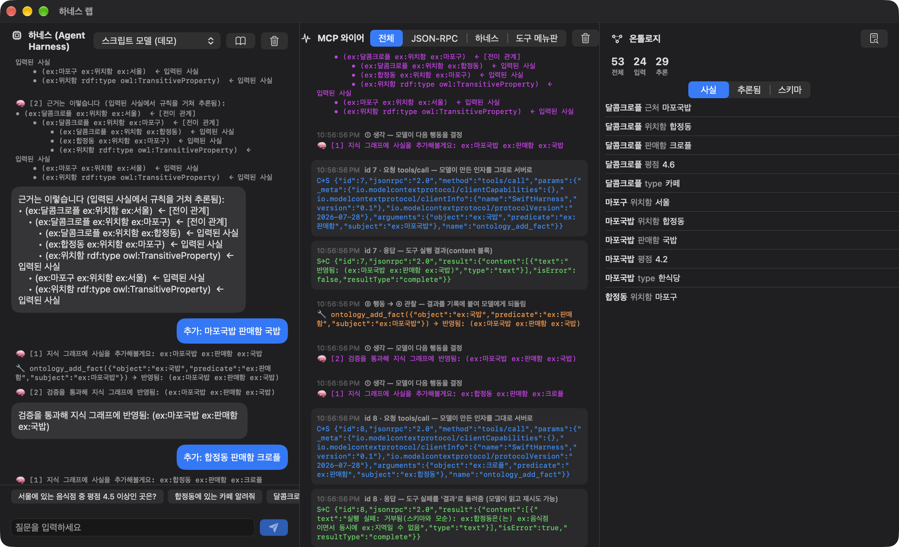
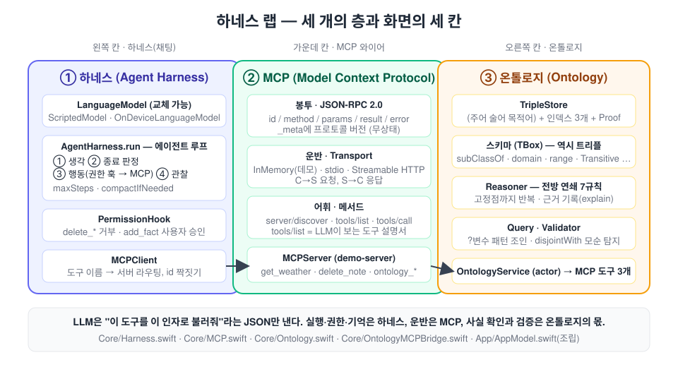
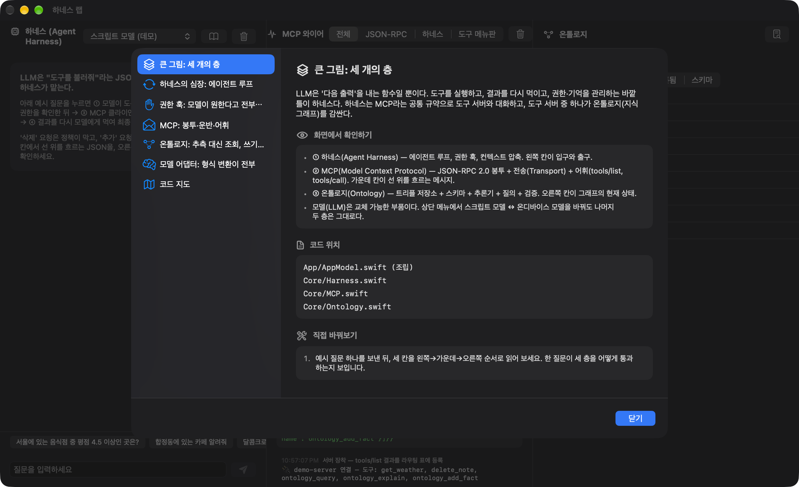
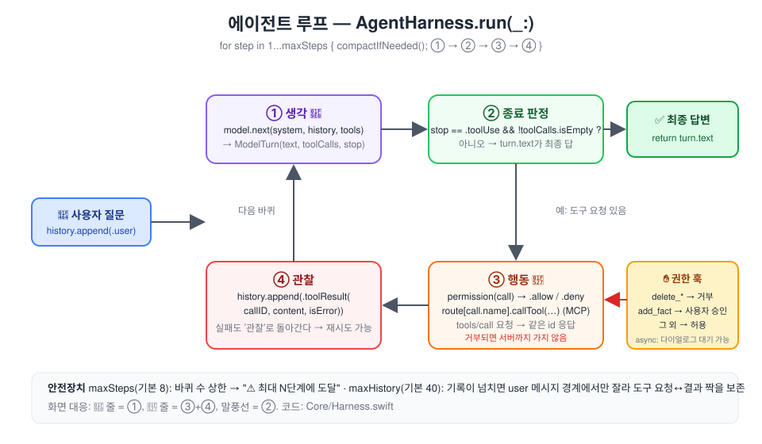
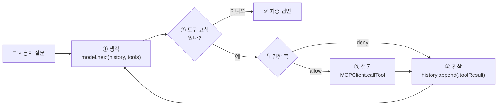
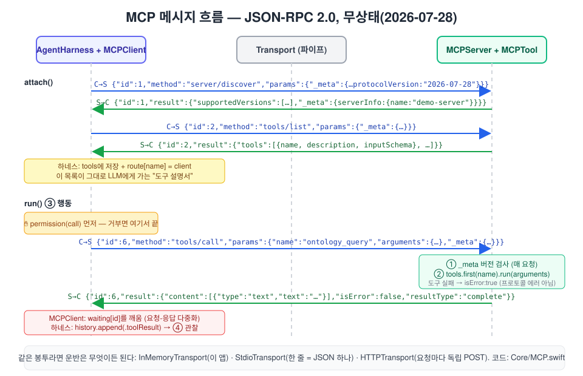
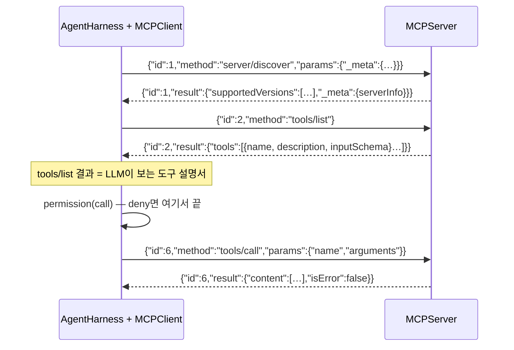
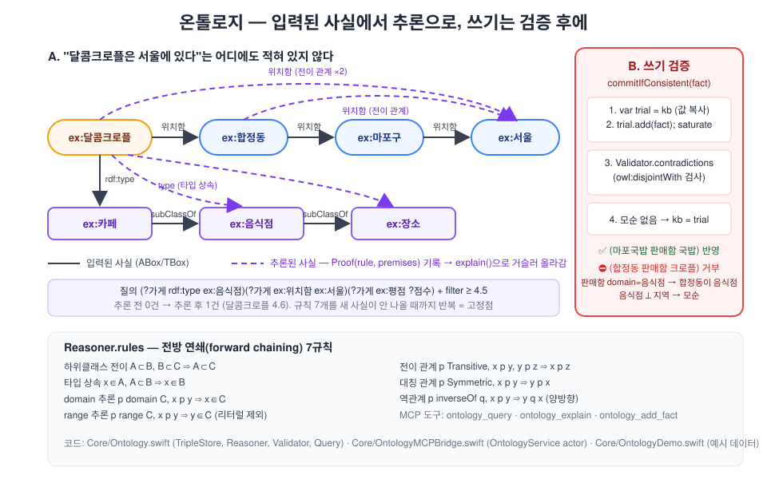
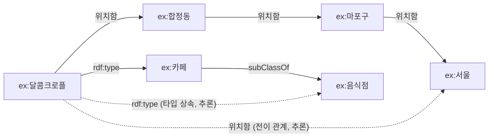

# 하네스 랩 (Harness Lab)

> **LLM은 "이 도구를 이 인자로 불러줘"라는 JSON만 낸다. 실행·권한·기억은 하네스, 운반은 MCP, 사실 확인과 검증은 온톨로지의 몫.**
> 이 세 문장을 한 화면에서 눈으로 확인하는 교육용 Swift 앱입니다.




| 왼쪽 칸 · 하네스 | 가운데 칸 · MCP 와이어 | 오른쪽 칸 · 온톨로지 |
|---|---|---|
| 질문을 보내면 🧠 모델의 결정 → 🔧 도구 실행 → 최종 답이 순서대로 쌓입니다. | 클라이언트↔서버 사이를 흐르는 JSON-RPC 봉투를 **그대로**, 각 메시지가 무엇인지 한 줄 해설과 함께 보여줍니다. | 지식 그래프의 사실·추론·스키마를 구분해 보여주고, 트리플을 누르면 "왜 아는가" 근거 트리가 뜹니다. |

---

## 왜 만들었나

에이전트(agent)라는 말이 흔해졌지만, 실제로 **무엇이 LLM의 일이고 무엇이 바깥 코드의 일인지**는 잘 드러나지 않습니다. 이 앱은 그 경계를 보여주기 위해 세 가지를 외부 의존성 없이 직접 구현했습니다.

| 층 | 무엇을 배우나 | 코드 |
|---|---|---|
| ① **하네스 (Agent Harness)** | 에이전트 루프(생각 → 종료 판정 → 행동 → 관찰), 권한 훅, 컨텍스트 압축 | `MyApp/Core/Harness.swift` |
| ② **MCP (Model Context Protocol)** | JSON-RPC 2.0 봉투, 전송(메모리 파이프·stdio·HTTP), `server/discover`·`tools/list`·`tools/call`, 무상태 `_meta` | `MyApp/Core/MCP.swift` |
| ③ **온톨로지 (Ontology)** | 트리플 저장소, 스키마도 트리플, 전방 연쇄 추론 7규칙, `?변수` 패턴 질의, `disjointWith` 검증, 근거 추적 | `MyApp/Core/Ontology.swift` |

모델은 교체 가능한 부품입니다. 기본은 규칙 기반 **스크립트 모델**(항상 같은 결과, 수업용)이고, Apple Intelligence가 켜진 기기에서는 **온디바이스 Foundation Models**로 바꿔 같은 질문을 던져 볼 수 있습니다. 어느 쪽이든 모델은 도구를 직접 실행하지 않습니다.



---

## 빠른 시작

요구 사항: Xcode 26 이상, macOS 27 / visionOS 27 / iOS 27 SDK. 외부 패키지 없음.

1. `Untitled Project.xcodeproj`를 열고 스킴 **MyApp**, 실행 대상 **My Mac**(또는 Apple Vision Pro 시뮬레이터)을 고릅니다.
2. ⌘R.
3. 왼쪽 칸 아래의 예시 질문 버튼을 차례로 누릅니다.

| 예시 질문 | 무엇을 보여주나 |
|---|---|
| 서울에 있는 음식점 중 평점 4.5 이상인 곳은? | 추론 없이는 0건인 질의가 추론 후 1건이 되는 과정 (`ontology_query`) |
| 왜 달콤크로플이 서울에 있다고 알아? | 입력 사실 → 전이 관계 규칙 → 결론의 근거 트리 (`ontology_explain`) |
| 추가: 마포국밥 판매함 국밥 | 승인 다이얼로그 → 검증 통과 → 그래프 반영 (`ontology_add_fact`) |
| 추가: 합정동 판매함 크로플 | 환각 사실이 스키마 모순으로 **거부**되는 과정 (`isError: true`) |
| 7번 메모 삭제해줘 | 권한 훅이 서버 전송 **전에** 막는 과정 (와이어 칸에 `tools/call`이 없음) |
| 서울 날씨 어때? | 가장 단순한 도구 호출 한 바퀴 |

상단 책 아이콘(📖)을 누르면 **학습 가이드**가 열립니다. 개념 → 화면에서 확인 → 코드 위치 → 직접 바꿔보기 순서로 7개 장이 들어 있습니다.



---

## 동작 원리

### 에이전트 루프





### MCP 위를 흐르는 것





### 온톨로지: 추측 대신 조회, 쓰기는 검증 후에





---

## 코드 지도

```
MyApp/
├── Core/                      # UI 없이도 동작하는 학습용 라이브러리 (의존성: Foundation만)
│   ├── MCP.swift              # JSONValue · LogEntry/LogSink · RPCMessage · Transport 3종 · MCPServer · MCPClient
│   ├── Harness.swift          # Message · ToolCall · LanguageModel · Permission · AgentHarness(에이전트 루프)
│   ├── Ontology.swift         # Term · Triple · V(어휘) · TripleStore · Reasoner · Validator · Query · Ontology
│   ├── OntologyMCPBridge.swift# OntologyService(actor) → ontology_query / ontology_explain / ontology_add_fact
│   ├── OntologyDemo.swift     # 예시 그래프(합정동 가게들) · 단계별 리포트 · 예시 질문
│   └── ScriptedModel.swift    # 규칙 기반 데모 모델 — "진짜 LLM이 하는 일"을 결정적으로 흉내
├── App/
│   ├── AppModel.swift         # 조립(원래 main.swift 역할) · 승인 흐름 · 로그 스트림
│   ├── OnDeviceLanguageModel.swift # Apple Foundation Models 어댑터 (@Generable 구조화 출력)
│   ├── LearningGuide.swift    # 앱 내 학습 가이드 본문
│   └── LearningGuideView.swift
├── ContentView.swift          # 세 칸 화면 + 와이어 해설(WireAnnotator)
└── MyApp.swift
Docs/
├── TechPRD.md                 # 기술 PRD
├── Tasks.md                   # 태스크 목록과 상태
├── Training.md                # 직원 교육 커리큘럼 (3세션)
├── diagrams/*.svg
└── screenshots/*.png
```

읽는 순서는 위에서 아래, 의존 방향과 같습니다. `Core/`만 떼어 명령줄 도구에 넣어도 돌아갑니다(`Docs/Training.md` 부록 참고).

### 설계 메모

- **로그가 곧 교재.** `print` 대신 `LogSink` 콜백으로 모든 층의 이벤트를 한 스트림에 모읍니다. UI는 그 스트림을 세 칸으로 나눠 보여줄 뿐, 라이브러리 코드는 UI를 모릅니다.
- **권한 훅은 async.** 사용자 승인이 필요한 도구는 `CheckedContinuation`으로 다이얼로그의 클릭을 기다립니다. "모델이 원한다고 전부 실행하지 않는다"가 코드 한 줄로 보입니다.
- **값 타입이 가상 세계.** `TripleStore`가 struct라 `var trial = kb` 한 줄이 곧 "먼저 넣어보고 모순이면 버리는" 트랜잭션입니다.
- **MainActor 기본 격리.** 프로젝트가 `SWIFT_DEFAULT_ACTOR_ISOLATION = MainActor`라 actor 사이를 오가는 Core 타입은 전부 `nonisolated`로 선언했습니다. (`typealias`에는 붙일 수 없습니다.)

---

## 검증

- 예시 질문 8개 전부 `RunCodeSnippet`과 실제 실행으로 확인 (2026-10-01).
- macOS · visionOS 시뮬레이터 · iOS 시뮬레이터 빌드 성공, 경고 0.
- DEBUG 빌드 실행 인자: `-autoDemo`(예시 질문 6개 자동 실행, 승인 자동 허용), `-showGuide`(학습 가이드 열고 시작).

```bash
xcodebuild -project "Untitled Project.xcodeproj" -scheme MyApp \
  -destination 'generic/platform=visionOS Simulator' CODE_SIGNING_ALLOWED=NO build
```

## 문서

- [기술 PRD](Docs/TechPRD.md) · [태스크](Docs/Tasks.md) · [교육 커리큘럼](Docs/Training.md)

## 라이선스

Apache License 2.0 — [LICENSE](LICENSE), [NOTICE](NOTICE).
MCP는 공개 스펙의 교육용 재구현이며 공식 SDK가 아닙니다. 온톨로지는 RDF/RDFS/OWL 개념의 축소판입니다. 가게 이름은 예시용 가상 이름입니다.

---

## English summary

**Harness Lab** is a dependency-free SwiftUI teaching app (macOS / visionOS / iOS 27) that makes the boundary between an LLM and its surroundings visible on one screen:

- **Agent harness** — the think → decide → act → observe loop, an async permission hook (destructive tools denied by policy, graph writes require user approval), context compaction.
- **MCP** — a from-scratch JSON-RPC 2.0 implementation of the stateless 2026-07-28 spec (`server/discover`, `tools/list`, `tools/call`, `_meta` versioning) over an in-memory pipe, with every envelope shown live and annotated.
- **Ontology** — a triple store with schema-as-triples, forward-chaining reasoner (7 rules), pattern queries, `disjointWith` validation and proof trees; exposed to the harness as three MCP tools so the model *queries* instead of guessing and *writes* only after validation.

The model is pluggable: a deterministic scripted model for classrooms, or Apple's on-device Foundation Models via structured output. In both cases the model only emits a tool request; the harness executes it. Licensed under Apache-2.0.
